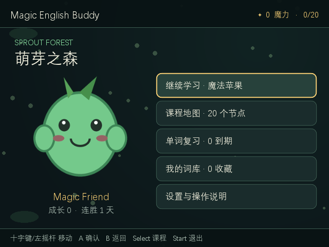
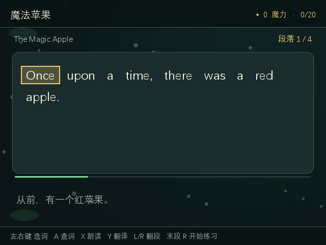
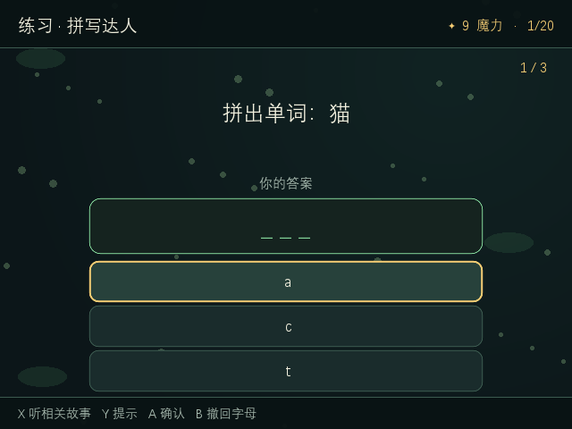
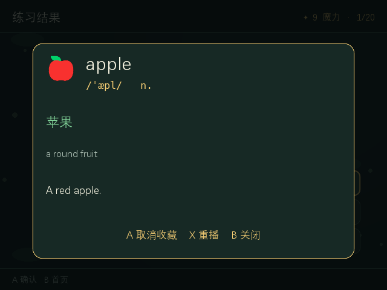

# English Buddy · 魔力英语伙伴

一个完全离线的英语启蒙学习应用，基于 **Godot 3.5.3** 构建，画面为 640×480 横屏。最初为 R36S 等开源掌机（PortMaster）设计，同样可以用键盘在 PC 上直接运行。



## 功能

- **孵化伙伴**：按住确认键孵化专属学习伙伴，伴随成长阶段变化
- **课程地图**：9 个循序渐进的课程，带解锁与完成进度
- **故事跟读**：逐词高亮、中英对照、段落音频播放，点击单词查词
- **互动测验**：看图选词、字母组词两种题型，答错有提示与讲解
- **魔力奖励**：完成阅读与测验积累魔力值，解锁后续内容
- **英语词典**：音标（IPA）、词性、释义、例句，支持发音
- **复习与词库**：错词回顾、按页浏览已学词汇
- **设置**：音效开关、进度重置





## 运行

### PC（Godot 3.5.3）

用 Godot 3.5.3 打开 `project.godot`，按 F5 运行；或命令行：

```bash
godot --path .
```

### 掌机（PortMaster）

将 `english-buddy.pck`、`english-buddy.gptk`、`english-buddy.sh` 放入
`/roms/ports/english-buddy/`，通过 PortMaster 菜单启动即可。

## 操作

| 功能 | 键盘 | 手柄 |
| --- | --- | --- |
| 移动 / 选择 | W A S D、方向键 | 方向键 / 左摇杆 |
| 确认（孵化需长按） | J、空格、回车 | A |
| 返回 | K、Esc | B |
| 重播音频 | L | X |
| 提示 / 翻译 | U | Y |
| 上一页 / 下一页 | Q / R | L1 / R1 |
| 菜单 | P | Select |

详细的掌机按键映射见 [`english-buddy.gptk`](english-buddy.gptk)。

## 项目结构

```
english-buddy/
├── data/content.json      # 唯一内容源：课程、故事、测验、词典
├── scripts/               # GDScript 逻辑（App、UIKit、Chrome、WordView 等）
├── scenes/Main.tscn       # 主场景
├── assets/
│   ├── audio/             # 段落与单词音频（MP3）
│   ├── icons/             # 表情图标、伙伴立绘、背景
│   └── fonts/             # ui.ttf 界面字体、ipa.ttf 音标字体
├── tools/                 # 资源生成、冒烟测试、渲染检查脚本
└── docs/screenshots/      # 示例截图
```

所有学习内容集中在 `data/content.json`，新增课程或词条无需改动代码。

## 开发与测试

```bash
# 重新生成图标与字体子集（需要 Python + fontTools + Pillow，使用 Windows 系统字体）
python tools/prepare_assets.py

# 冒烟测试：数据一致性、页面构建、关键流程
godot --path . --script res://tools/smoke.gd

# 渲染全部页面到 .build/screenshots/
godot --path . --script res://tools/render_all.gd
```

`tools/import_reference.mjs` 是从最初参考项目迁移内容的一次性脚本，依赖同级的
`magic-english-buddy-main` 目录，日常开发不需要它。

## 存档

进度保存在 Godot 用户目录下的 `english_buddy_profile.json`（Windows 通常为
`%APPDATA%/Godot/app_userdata/Magic English Buddy/`）。在设置页可以重置。

## 协议

[MIT](LICENSE) © 2026 liangdabiao
